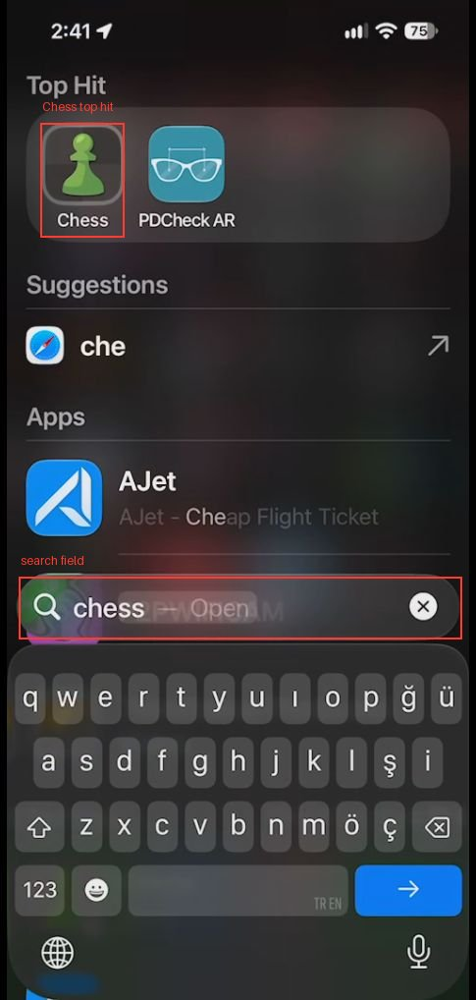
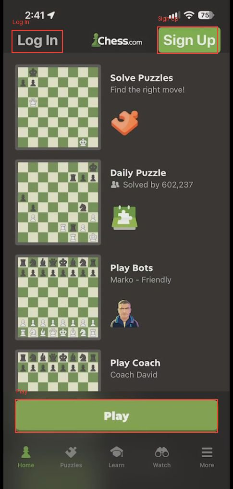
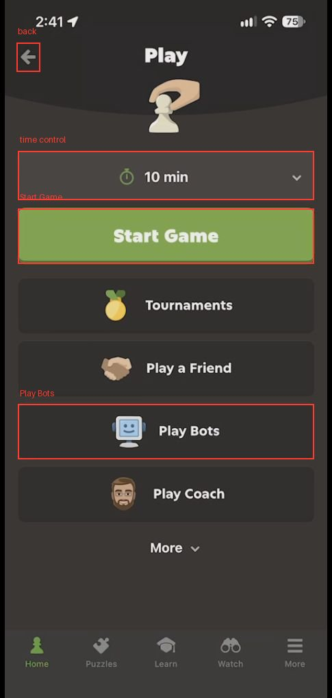
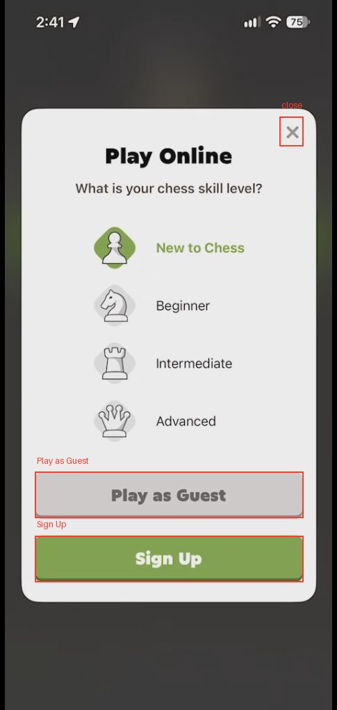
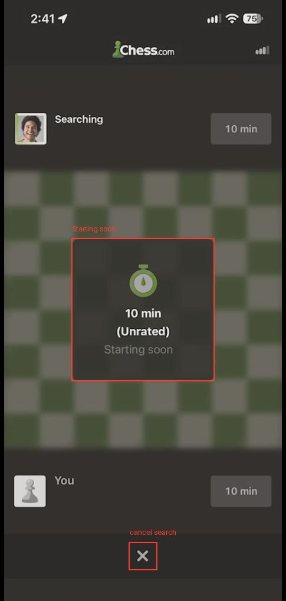
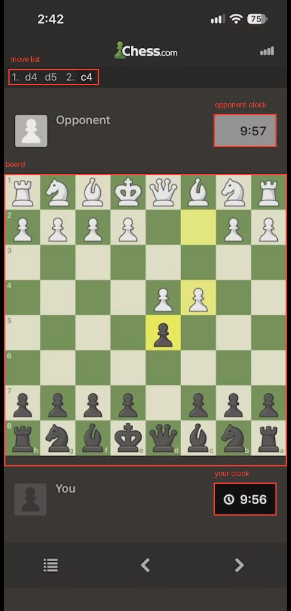

# Chess

Chess.com client. Not logged in in the recording: home shows Log In / Sign Up; online games are played as Guest (unrated, real human opponent).

## Hard rules
- Start Game (Play screen) matches you against a real person and starts their clock. Only tap it when the user asked to play online; confirm the time control (default 10 min) first.
- Every chess move is final in an online game (no takeback). Do not move unless the user told you to play or named the move; check the piece and target square (board may be flipped) before releasing.
- Never resign, abort, or leave a running game (X, back, closing the app counts as abandoning / losing on time) without the user's explicit yes.
- Never tap Sign Up / Log In or enter account details without the user's explicit yes and their data.

## Screens
### Spotlight search  
iOS search, not the app. Swipe down on the home screen (or tap the "Search" pill above the dock), type "chess". Top Hit row shows the green-pawn "Chess" icon at top left (~0.17, 0.21). Field at ~0.5, 0.62 shows "chess — Open".

### Splash  
Green "Chess.com" logo with a big pawn between a knight and rook. Shows ~1-2 s after launch; just wait.

### Home  
Header: "Log In" (top left), Chess.com logo, green "Sign Up" (top right). Cards: Solve Puzzles, Daily Puzzle, Play Bots, Play Coach. Big green "Play" button pinned above the tab bar (~0.5, 0.855). Tabs: Home, Puzzles, Learn, Watch, More.

### Play  
Title "Play", back arrow top left. Time control dropdown ("10 min", ~0.5, 0.276), green "Start Game" (~0.5, 0.358), then Tournaments, Play a Friend, Play Bots, Play Coach, More.

### Play Online popup  
White modal "Play Online – What is your chess skill level?": New to Chess (preselected, green), Beginner, Intermediate, Advanced; grey "Play as Guest" (~0.5, 0.707), green "Sign Up" (~0.5, 0.793), X top right. Appears on first Start Game when not logged in.

### Matchmaking  
Blurred board, card "10 min (Unrated) Starting soon", top player "Searching". X at bottom center cancels the search (safe before a match is found). Usually resolves within seconds.

### Game board  
Opponent bar with clock at top (~0.85, 0.24), board from y ≈0.31 to 0.77, "You" bar with your clock bottom (~0.84, 0.84). Your clock turns black with a timer icon when it is your move. Move list appears under the logo (e.g. "1. d4 d5 2. c4"). Bottom bar: move list icon (left), < > to step through moves (review only, does not undo).
The board is shown from your side: your pieces are at the bottom. In the recording the user was Black, so files run h→a left to right and rank 1 is at the top. Squares are ~0.12 wide and ~0.057 tall; column centres x ≈ 0.08, 0.20, 0.32, 0.44, 0.56, 0.68, 0.80, 0.92; row centres y ≈ 0.34, 0.40, 0.45, 0.51, 0.57, 0.62, 0.68, 0.73 (top to bottom). Read the small file/rank letters on the board edges to map squares. Last move is highlighted in yellow.

## Tasks
### open-and-play-online-game
Goal: launch Chess and get into a live game (guest, unrated).
1. Home screen: open Spotlight and type "chess" (inferred). Chess appears as Top Hit.
2. Tap the Chess icon in Top Hit (inferred). Splash appears, then Home.
3. Home: tap the green "Play" button above the tab bar (inferred). Play screen opens.
4. Play: check the time control, then tap "Start Game" (inferred). If not logged in, the Play Online popup appears.
5. Popup: tap "Play as Guest" (inferred). In the recording this returned to the Play screen without starting.
6. Play: tap "Start Game" again (inferred). Matchmaking shows "10 min (Unrated) Starting soon".
7. Wait until the board with "Opponent" and "You" appears and clocks read 10:00 (inferred).
8. Make moves when your clock is active: tap your piece then the target square (or drag it) (inferred). Recording: as Black, after 1. d4 the user played d7→d5.
Success: the move list under the logo grows and your piece sits on the new square; the opponent's clock starts.

## Pitfalls
- All gestures in the recording were done directly on the device, so exact tap points are estimates; locate elements on the live screen.
- First Spotlight attempt had leftover text "ch" selected; clear the field (x at right) and type "chess" fresh.
- After "Play as Guest" the app went back to the Play screen instead of starting matchmaking; tap Start Game a second time.
- You may be assigned Black: the board is flipped (h-file on the left, rank 1 at top). Always read the edge labels before computing a square.
- The time on the clocks keeps running while you think; don't leave a live game idle.